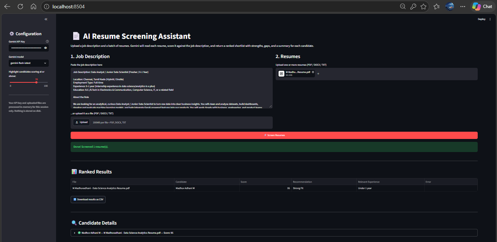
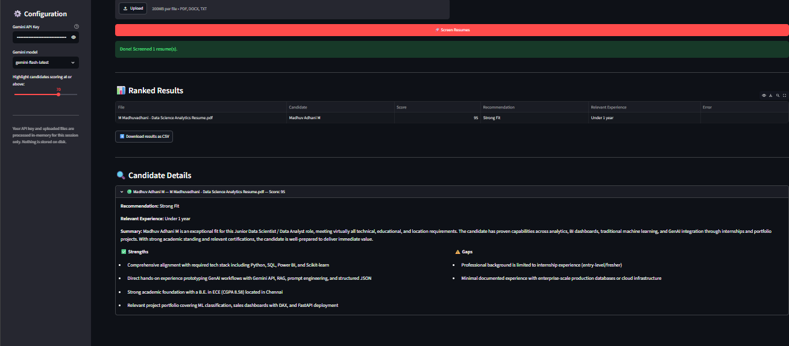

# AI Resume Screening Assistant

A GenAI-powered app that screens and ranks resumes against a job description
using Google Gemini. Upload a job description and a batch of resumes (PDF,
DOCX, or TXT), and get back a ranked shortlist with match scores, strengths,
gaps, and a summary for each candidate.

## Demo




## Features

- Upload job description as pasted text or a file
- Bulk upload resumes (PDF / DOCX / TXT)
- Each resume is scored 0–100 against the job description using Gemini
- Structured output per candidate: score, recommendation, strengths, gaps,
  years of relevant experience, and summary
- Ranked results table, exportable to CSV
- Expandable detail view per candidate

## How It Works

1. Resume text is extracted from PDF/DOCX/TXT files.
2. The job description and resume are sent to Gemini with a recruiter-style prompt.
3. Gemini returns structured JSON (score, strengths, gaps, summary) using JSON mode with a response schema.
4. Results are ranked by score and shown in a table with a CSV export.

## Tech Stack

- Python, Streamlit (UI)
- Google Gemini API (AI evaluation)
- pypdf, python-docx (resume parsing)
- pandas (results table)

## Setup

1. Install dependencies:

   ```bash
   pip install -r requirements.txt
   ```

2. Get a free Gemini API key from https://aistudio.google.com/apikey

3. Run the app:

   ```bash
   streamlit run app.py
   ```

4. Paste your Gemini API key in the sidebar.

## Usage

1. Paste or upload the job description.
2. Upload one or more resumes.
3. Click **Screen Resumes**.
4. Review the ranked table, expand any candidate for full detail, or
   download all results as a CSV.

## Limitations

- The score is an AI judgment, not an official ATS score. It should support recruiters, not replace human decisions.
- Uses direct LLM evaluation (no embeddings/vector search), so it is best suited to small and medium batches.